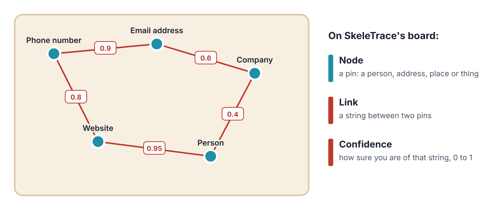
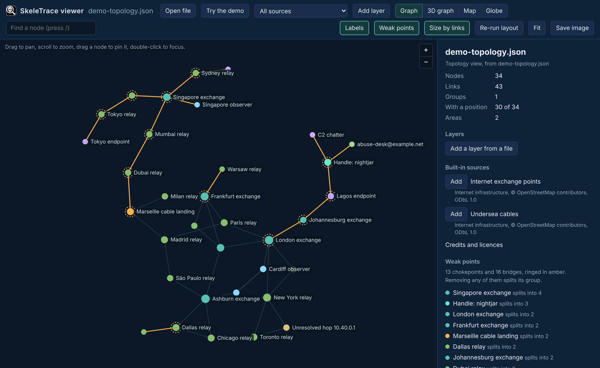
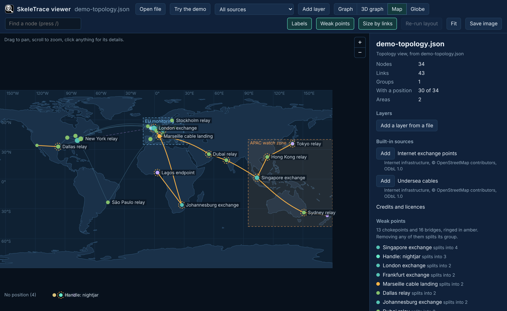
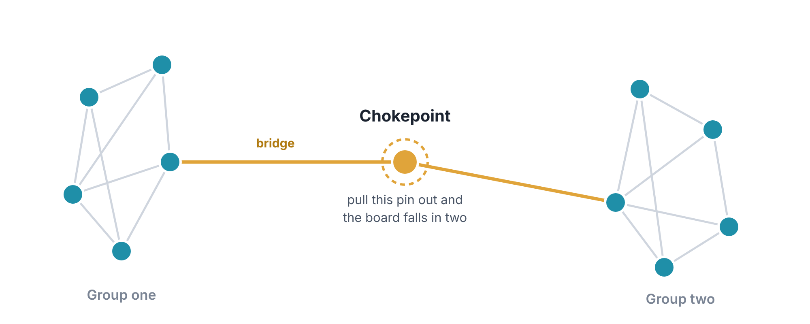
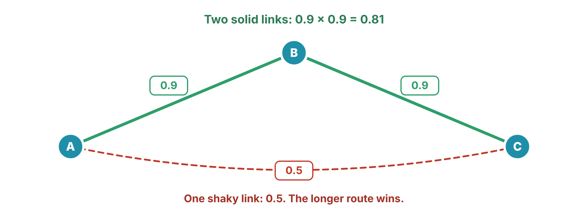
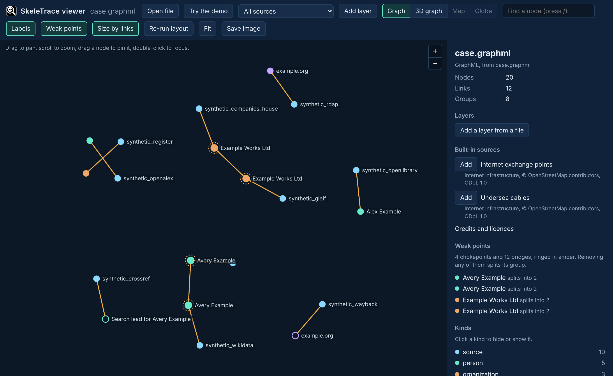

# SkeleTrace

*A detective’s pinboard that does the maths: which pin holds the whole case together, and which chain of string you can actually trust.*

SkeleTrace 1.0.2 · a quickstart guide from whispr.dev

You’ve seen it in films: a wall covered in photos, notes and maps, joined by red string. SkeleTrace is that pinboard, done properly. Each pin is a person, an address, a website or a place. Each string is a connection, and you say how sure you are of it. Then SkeleTrace does the parts that are hard by eye: it finds the one pin that holds everything together, the most believable chain from one pin to another, and which pins sit inside an area on the map.

## What it does, in one minute

An investigation built from open sources is mostly a list of **things** and the **connections** between them. A phone number appears on a website. The website is registered to a company. The company shares an address with a person. Written as a list, it’s hard to see. Drawn as a picture, patterns jump out.

<figure>

<figcaption aria-hidden="true">SkeleTrace’s way of seeing a case. Each string has a number from 0 to 1: how sure you are that the connection is real.</figcaption>
</figure>

SkeleTrace comes in two parts:

- **The engine**, a program called `skeletrace`. It does the calculations and writes the results as files.
- **The viewer**, a web page at **skeletrace.com/viewer**. It draws those files as a graph, a 3D graph, a flat map or a globe. Your files never leave your computer: the page reads them inside your browser and sends nothing back.

> **Words you'll meet**
>
> **Node:** one pin on the board. A person, an email address, a server, a ship, a place.
>
> **Link:** one string between two nodes.
>
> **Confidence:** how sure you are of a link, from 0 (not at all) to 1 (certain).
>
> **Group:** a set of nodes that are all joined to each other, directly or through others.
>
> **Weak point:** a node or link that holds a group together. Pull it out and the group falls apart.
>
> **JSON:** a plain-text file format for data, made of names and values in curly brackets. SkeleTrace reads and writes it.

## Get it on your computer

The engine is free. Download it from **skeletrace.com/download**, or from the **Releases** page of github.com/whisprer-specops/skeletrace. The viewer needs no download at all: it’s a web page.

| Your computer             | Download                              | Then                                                                                                                                               |
|---------------------------|---------------------------------------|----------------------------------------------------------------------------------------------------------------------------------------------------|
| Windows 10 or 11          | `skeletrace-windows-x86_64-setup.exe` | Double-click it. Windows may say “Windows protected your PC”, because the program isn’t code-signed yet. Click **More info**, then **Run anyway**. |
| Mac (Apple chip or Intel) | `skeletrace-macos-universal.run`      | Open Terminal and type `sh ~/Downloads/skeletrace-macos-universal.run`                                                                             |
| Linux (most PCs)          | `skeletrace-linux-x86_64.run`         | Open a terminal and type `sh ~/Downloads/skeletrace-linux-x86_64.run`                                                                              |
| Linux on ARM              | `skeletrace-linux-aarch64.run`        | As above, with that file name                                                                                                                      |

Each installer shows the licence and asks you to accept it (on a Mac or Linux, press Space to page through, then type `y`). It then suggests a folder: on Windows `%LOCALAPPDATA%\Programs\SkeleTrace`, on a Mac `~/Applications/SkeleTrace`, and on Linux `~/SkeleTrace`. Press Enter to accept. Nothing else on your computer changes; to remove SkeleTrace, delete the folder.

## Your first five minutes: the viewer’s demo

The quickest way to understand SkeleTrace is to look at a finished case. The viewer has one built in, with invented places and names.

1.  Open **skeletrace.com/viewer** in your web browser.

2.  Click **Try the demo**. A made-up network of exchanges and relays appears, spread across the world.

3.  Try the four views at the top: **Graph**, **3D graph**, **Map** and **Globe**. The keys 1 to 4 do the same.

4.  Click any node to see its details on the right. Drag the empty space to move around, and scroll to zoom.

<figure>

<figcaption aria-hidden="true">The demo case in the Graph view. Nodes ringed with a dashed amber circle, and the amber links, are weak points. The panel on the right lists them, with how many pieces each one would leave behind.</figcaption>
</figure>

The **Graph** view arranges the pins so that connected ones sit close together, like pulling the board’s strings tight. It ignores geography, which is often the clearest way to see the shape of a case. The **Map** and **Globe** views put every node that has a position in its real place.

<figure>

<figcaption aria-hidden="true">The same case on the Map view. The dashed boxes are areas drawn in the case file: an “EU monitoring” zone and an “APAC watch zone”.</figcaption>
</figure>

> **Tip**
>
> Click **Weak points** to turn the amber rings on or off, **Labels** for the names, and **Save image** to keep a picture of what you see. Press `/` to search for a node by name.

## The four tools, in plain English

### 1. Weak points: the pin that holds it all together

A **chokepoint** is a node that holds its group together. If you took it away, the group would fall into separate pieces. A **bridge** is the same idea for a link: the only string between two parts of the board.

<figure>

<figcaption aria-hidden="true">Two tightly connected groups joined through a single node. That node is a chokepoint, and each of its two links is a bridge.</figcaption>
</figure>

Weak points matter because they tell you where to look first. In a network of servers, a chokepoint is the one machine everything passes through. In a case about people, it can be the one person who connects two circles, or the one piece of evidence your whole theory rests on. In the demo, the viewer says “Singapore exchange splits into 4”: remove it, and its group breaks into four pieces.

### 2. The strongest chain: which route can you trust?

Say you want to know how node A connects to node C. There may be several routes through the board. Each link has a confidence, and a chain is only as believable as all its links together, so SkeleTrace **multiplies** them.

<figure>

<figcaption aria-hidden="true">Two solid links beat one shaky one. 0.9 × 0.9 = 0.81, which is more believable than 0.5.</figcaption>
</figure>

> **Think of it like this**
>
> It’s like hearing a story second-hand. If two people you trust nine times out of ten pass it along, you can still trust it about eight times out of ten. If it comes straight from someone you trust half the time, you can’t do better than a coin toss.

### 3. Geofences: what’s inside this area?

A **geofence** is an area drawn on a map, such as a port, a district or a country. SkeleTrace tells you which nodes are inside each one, which sit exactly on the edge, and which are outside, along with the area’s size in square kilometres. It can also draw the tightest outline around every node that has a position, and tell you how much ground they cover.

You can draw fences for free at geojson.io, or in mapping software such as QGIS, and save them as a `.geojson` file.

### 4. Text sweeps: find every name on a watch list

This is the easiest tool to try on your own files, and it needs no setup. Give it a **watch list**, one term per line: email addresses, usernames, phone numbers. Then give it any number of text files to search: forum dumps, saved web pages, logs. It reads each file once, however big, and reports every match with its line and column.

It can also catch **near-misses**: words that are one or two typos away from a term. That matters, because people misspell things, by accident and on purpose.

| Term length          | Typos it will forgive                |
|----------------------|--------------------------------------|
| Up to 4 characters   | None: exact matches only             |
| 5 to 7 characters    | 1                                    |
| 8 characters or more | 2 (or 1, if you ask for `--fuzzy 1`) |

A **typo** here means one character added, dropped or changed, or two neighbouring characters swapped. Short terms get no typos because they’d match too many ordinary words: “moth” is one typo away from “math”, “both” and “mote”.

## Try a text sweep yourself

1.  Open a terminal and go to the program’s folder. On Windows:

    ``` powershell
    cd "$env:LOCALAPPDATA\Programs\SkeleTrace"
    ```

    On a Mac, type `cd ~/Applications/SkeleTrace`; on Linux, `cd ~/SkeleTrace`. Then use `./skeletrace` wherever this guide says `.\skeletrace.exe`.

2.  Make a watch list with three terms, and a small file to search. Copy these lines into the terminal:

    ``` powershell
    $terms = "lantern@example.org", "jdoe88", "@moth_relay"
    $terms | Set-Content -Encoding utf8 watch.txt
    $lines = "notes from a forum dump", "user=jdeo88 posted again",
             "contact: lantern@exmaple.org", "relay handle @moth_relay seen twice"
    $lines | Set-Content -Encoding utf8 dump-1.txt
    ```

    On a Mac or Linux, these four lines do the same:

    ``` bash
    printf '%s\n' 'lantern@example.org' 'jdoe88' '@moth_relay' > watch.txt
    printf '%s\n' 'notes from a forum dump' 'user=jdeo88 posted again' > dump-1.txt
    printf '%s\n' 'contact: lantern@exmaple.org' >> dump-1.txt
    printf '%s\n' 'relay handle @moth_relay seen twice' >> dump-1.txt
    ```

3.  Sweep the file, forgiving up to two typos:

    ``` powershell
    .\skeletrace.exe sweep-text --fuzzy 2 watch.txt dump-1.txt
    ```

The answer comes back as JSON, a long list of names and values. Tidied up, this is what it found:

``` text
Exact hits
  @moth_relay           line 4, column 14   "@moth_relay"
Near-misses
  jdoe88                line 2, column 6    "jdeo88"                1 typo
  lantern@example.org   line 3, column 10   "lantern@exmaple.org"   1 typo
```

One exact hit, and two near-misses that a plain search would have missed: `jdeo88` and `exmaple`, each with two neighbouring letters swapped. Each result says exactly where it is, so you can open the file and look.

> **Tip**
>
> To see the results as a neat table in PowerShell instead of raw JSON:
>
> ``` powershell
> $json = .\skeletrace.exe sweep-text --fuzzy 2 watch.txt dump-1.txt | Out-String
> $r = ($json | ConvertFrom-Json).Sweep
> $r.hits | Format-Table term, input, line, column, matched
> $r.near_hits | Format-Table term, matched, edits, line, column
> ```

> **Heads-up**
>
> Save files to search as UTF-8 text, the most common kind. If a file was saved as UTF-16 (some Windows tools do this), SkeleTrace warns you, because terms can’t match it; open it in Notepad and save it again as UTF-8.

## Open files from the other tools

The viewer opens more than SkeleTrace’s own files. Drag any of these onto the page, or click **Open file**:

| File                                  | Where it comes from                                                  |
|---------------------------------------|----------------------------------------------------------------------|
| SkeleTrace topology or GeoJSON output | The engine’s commands                                                |
| GraphML                               | OSINTropy’s case exports, and many graph tools                       |
| GeoJSON, KML, KMZ, GPX, CSV           | Mapping tools, GPS devices, spreadsheets with latitude and longitude |

<figure>

<figcaption aria-hidden="true">An OSINTropy case, exported as GraphML and opened in the SkeleTrace viewer. Sources are blue; people green; companies amber. Hollow rings are unverified leads.</figcaption>
</figure>

Click **Add layer** to put a second file on top of the first, or add one of the built-in public layers, such as internet exchange points and undersea cables, from the panel on the right.

## For the curious: the engine’s other commands

The weak points, strongest chain and geofence tools also run in the engine, on your own data. They take a **profile**, a JSON file that describes your sources and how to read them, and a **view**, a JSON file that says which part of the case to look at.

| Command                                | What it answers                                             |
|----------------------------------------|-------------------------------------------------------------|
| `analyze-topology PROFILE VIEW`        | Which groups are there, and what are their weak points?     |
| `strongest-chain PROFILE VIEW FROM TO` | What’s the most believable route between two nodes?         |
| `fence-check PROFILE VIEW FENCES`      | Which nodes are inside each fenced area?                    |
| `cover-area PROFILE VIEW`              | How much ground do the nodes cover?                         |
| `sweep-text TERMS FILE...`             | Where does each watch-list term appear? (No profile needed) |

Setting up a profile is the one fiddly part. The source code on GitHub includes a demonstration that writes a complete set of these files, ready to copy from, and the full guide there walks through it. `.\skeletrace.exe --help` lists every command.

## What it can and can’t tell you

> **What it can't tell you**
>
> **A weak point is a place to look, not a conclusion.** SkeleTrace shows that a case *rests* on one node or link. Whether that matters is your call.
>
> **Confidences are yours.** The strongest chain is only as good as the numbers you give each link. A 0.9 on a hunch is still a hunch.
>
> **Maps are flat-earth maths for small areas.** Geofence edges count as straight lines on a latitude and longitude map. That’s accurate for areas up to a few hundred kilometres across. Fences can’t cross the 180° line in the Pacific; split them in two.
>
> **A text sweep finds words, not meaning.** It can’t tell two people who share a username apart. Every hit is a lead to check.

## Cheat sheet

| To do this                       | Do this                                          |
|----------------------------------|--------------------------------------------------|
| See a finished example           | skeletrace.com/viewer, then **Try the demo**     |
| Open your own file in the viewer | Drag it onto the viewer, or click **Open file**  |
| Switch views                     | Keys `1` to `4` (Graph, 3D graph, Map, Globe)    |
| Find a node                      | Press `/` and type its name                      |
| Search files for a watch list    | `.\skeletrace.exe sweep-text watch.txt FILE...`  |
| Catch typos too                  | add `--fuzzy 2`                                  |
| Find a case’s weak points        | `.\skeletrace.exe analyze-topology PROFILE VIEW` |
| See every command                | `.\skeletrace.exe --help`                        |


## Where to go next

The viewer, the algorithm lab and the full guides are at skeletrace.com. The source code and release notes are on GitHub, at github.com/whisprer-specops/skeletrace.

The whole set, each one free software under GPL-3.0-only:

- **SkeleTrace**: A detective’s pinboard that does the maths
- **Maxwell’s Demon Detector**: Network traffic as a river of racing lanes
- **OSINTropy**: An evidence locker for public records
- **CrowdWatch**: What normal looks like, and when today isn’t

All four quickstart guides are at skeletrace.com/guides.

*SkeleTrace 1.0.2. © 2026 whispr.dev. Screenshots are from the program itself; every example in them is invented.*
